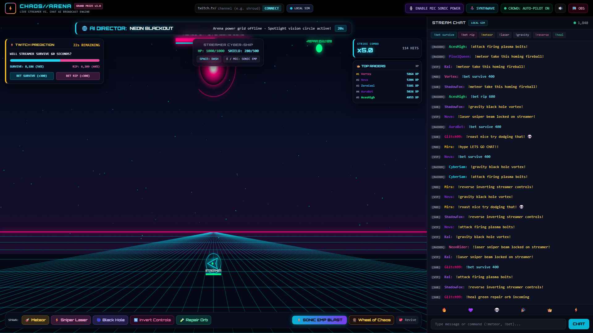
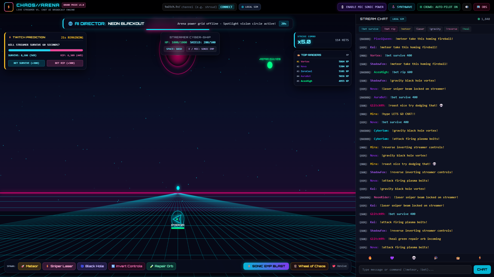
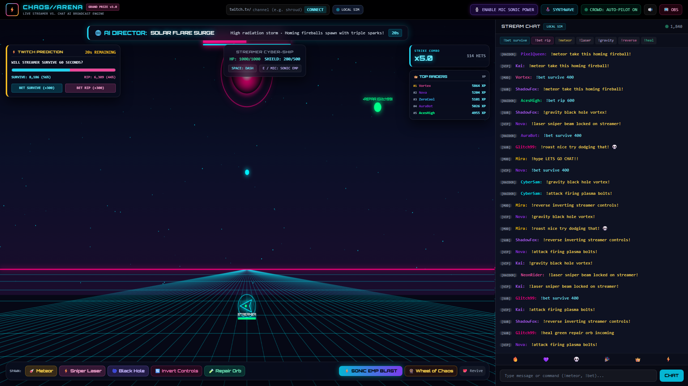
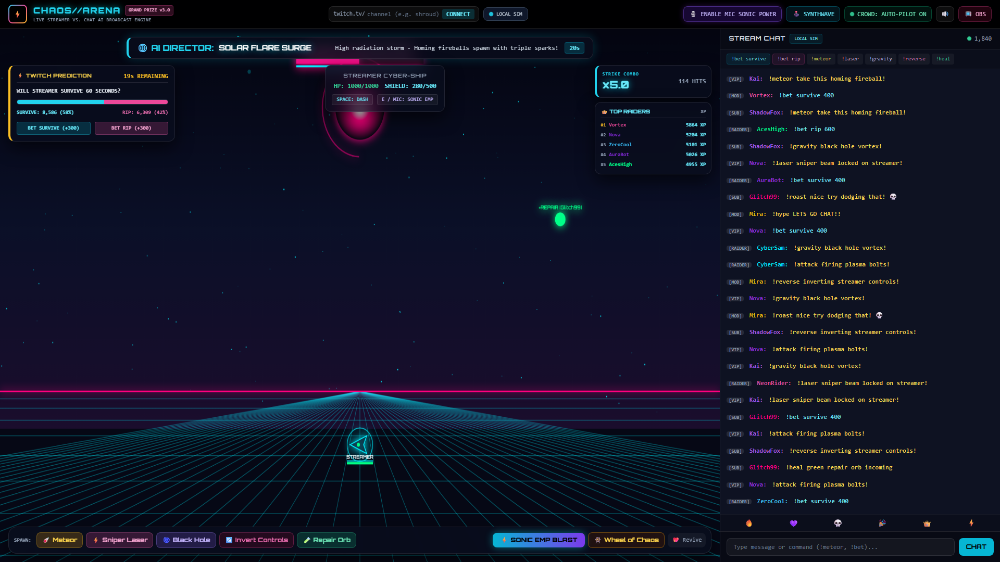
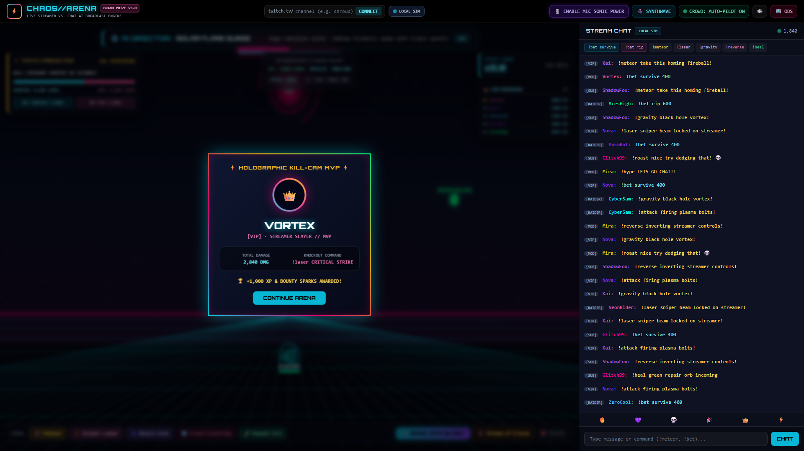
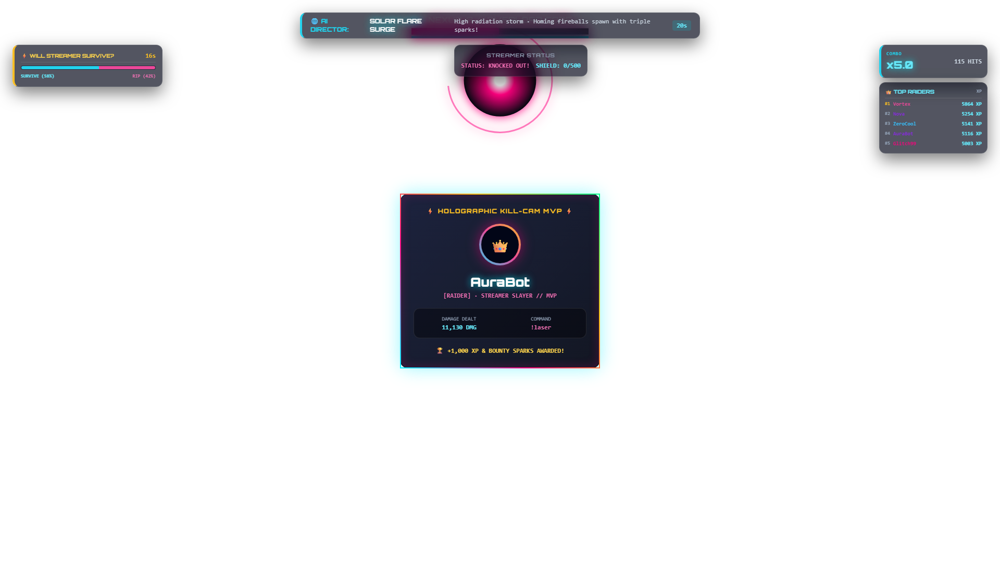

# CHAOS//ARENA — Live Twitch Chat vs. Streamer AI Game Master & Sabotage Engine

CHAOS//ARENA turns a Twitch chat into a live game master. Viewers launch hazards, alter the arena, place virtual Channel Spark predictions, and compete for the knockout while the streamer pilots a neon cyber-ship and fights back.

## What It Is

A Node.js broadcast engine with a live Twitch chat bridge, an Express HTTP API, a WebSocket event bus, a 60 FPS Canvas arena, and an OBS-ready transparent browser overlay. Auto-Pilot Chaos Simulator is enabled by default so the experience has activity before a Twitch channel is connected.

## Feature Matrix

| Feature | How it works | Interaction |
|---|---|---|
| Streamer vs. chat arena | Canvas ship movement, shields, homing hazards, collision damage, dash, and shockwaves | Mouse or WASD; commands: !meteor, !laser, !gravity, !reverse, !heal |
| Sonic EMP | Microphone analysis and speech recognition trigger a canvas-wide EMP | Enable mic and shout, say “ULTIMATE” / “SHIELD”, or press E |
| Crowd prediction | 60-second survival round tracks virtual Channel Sparks and resolves on survival or knockout | !bet survive 500 or !bet rip 500 |
| AI Game Director | Server rotates world mutations and broadcasts them live | Overclock, low gravity, blackout, and additional arena events |
| Dynamic commentary | Optional OpenAI gpt-4o-mini for hype, roasts, and boss taunts | !hype, !roast; curated lines are the no-key and API-error fallback |
| Boss & MVP moments | Boss state, phases, knockout handling, leaderboard XP, and animated MVP card | Chat attacks and lethal hazard collisions |
| Twitch channel bridge | Connect a channel without reloading the studio | Enter a channel in the studio and connect |
| OBS browser overlay | Transparent WebSocket-driven layer for stream output | Add localhost:3000/overlay as an OBS Browser Source |
| Local demo | Scripted events exercise the event pipeline without live Twitch | npm run mock or npm run demo |

## Visual Gallery

These six HD captures are generated by npm run media. Run the server first.

| Arena overview | Meteor and laser attack |
|---|---|
|  |  |
| Sonic EMP blast | Wheel of Chaos |
|  |  |
| MVP kill-cam card | OBS overlay |
|  |  |

## System Architecture

~~~mermaid
graph TD
    Twitch[Twitch IRC / tmi.js] -->|viewer messages and commands| Chat[Chat command router]
    Sim[Auto-Pilot Chaos Simulator] --> Chat
    Deck[Studio control deck] -->|HTTP or WebSocket actions| API[Express API]
    Chat --> Engine[Game and prediction state]
    API --> Engine
    Engine -->|typed live events| Hub[WebSocket event bus]
    Hub --> Studio[Studio dashboard]
    Hub --> Overlay[OBS transparent overlay]
    Studio --> Canvas[60 FPS Canvas renderer]
    Overlay --> Canvas
    Engine -->|optional request| OpenAI[OpenAI gpt-4o-mini]
    OpenAI -->|one-sentence commentary| Hub
    Engine -->|no key or API failure| Curated[Curated local commentary]
    Curated --> Hub
~~~

### Real-Time Event Flow

~~~mermaid
sequenceDiagram
    participant V as Twitch viewer
    participant T as tmi.js
    participant S as Express game server
    participant G as Game state
    participant O as Optional OpenAI
    participant W as WebSocket clients
    participant B as Browser Canvas / OBS

    V->>T: !meteor, !bet, !hype, or !roast
    T->>S: message event with viewer identity
    S->>G: validate command and update state
    G-->>W: hazard, prediction, or commentary event
    opt Commentary command and OPENAI_API_KEY configured
        S->>O: gpt-4o-mini one-sentence prompt
        O-->>S: short stream-safe line
    end
    opt OpenAI key missing, timeout, or API error
        S->>S: choose deterministic curated fallback
    end
    S-->>W: alert / boss taunt / game state
    W->>B: render Canvas animation and HUD update
    B-->>V: live broadcast feedback
~~~

## Voice Sonic EMP: Audio-Reactive Physics

The browser requests microphone permission with getUserMedia, feeds the microphone stream to a Web Audio AnalyserNode, and samples signal amplitude on animation frames. That amplitude drives the ship’s reactive ring. Speech Recognition listens for “ULTIMATE” and “SHIELD”; an amplitude threshold provides a shout trigger where supported. Pressing E remains the keyboard fallback.

An EMP animates a shockwave, clears enemy projectiles, and emits a synth pulse. Microphone and speech APIs require a user gesture and permission. OBS browser sources should use localhost or HTTPS for microphone access.

## GPT-4o-mini Commentary Pipeline

OPENAI_API_KEY is optional. When present, the server sends a short request to gpt-4o-mini for a single stream-safe sentence in response to hype, roast, boss phase, and low-health moments. Requests have a short timeout. Missing keys, unsupported fetch, non-success API responses, malformed responses, and timeouts all resolve to curated local commentary. Commentary generation is isolated from chat processing, so an AI outage does not stop the game event pipeline.

The server uses Node’s built-in fetch; no OpenAI npm dependency is required. Never commit a real API key.

## Twitch Prediction Economy

A live round starts with a 60-second survival timer and virtual Channel Sparks. Viewers can place a prediction with !bet survive <amount> or !bet rip <amount>. The HUD streams the current pool and odds. A surviving streamer resolves the round for Believers; a knockout resolves it for Doubters and awards the final attacker bonus XP. Sparks are demo points, not money and not redeemable value.

## Commands

| Command | Effect |
|---|---|
| !meteor | Launch a homing fireball |
| !laser | Fire a lock-on sniper beam |
| !gravity | Spawn a gravity vortex |
| !reverse | Invert ship steering temporarily |
| !heal | Spawn a shield orb to catch |
| !bet survive 500 | Add virtual Sparks to the survival pool |
| !bet rip 500 | Add virtual Sparks to the knockout pool |
| !hype | Generate or select a reactive hype line |
| !roast <message> | Generate or select a playful roast |
| !sonic | Trigger the Sonic EMP |
| !wheel | Spin the Wheel of Chaos |
| !attack | Chat strike that advances boss combat |

## Quick Start

### Requirements

- Node.js 18 or newer
- npm
- Optional Twitch channel and chat credentials
- Optional OpenAI API key for generated commentary
- Optional media tools: Playwright Chromium and FFmpeg; local speech synthesis is used for voiceover

### Install and Configure

1. Open a terminal in the repository and install packages: npm install
2. Copy .env.example to .env. Set TWITCH_CHANNEL to a public channel to connect. Leave it blank or at its example value to run locally. Add TWITCH_USERNAME and TWITCH_OAUTH_TOKEN only if authenticated chat access is needed.
3. Optionally set OPENAI_API_KEY. Without it, curated commentary is used automatically.
4. Start the server with npm start.
5. Open http://localhost:3000/. For OBS, add a Browser Source at http://localhost:3000/overlay and set the source to 1920 × 1080.

### Run a Local Demo

With the server running in one terminal, start the scripted mock chat in another with npm run mock. Or run the broader scenario with npm run demo. Use the studio chat input or POST /api/mock/chat to exercise commands without a live channel.

### Generate Screenshots and Demo Video

Install the browser automation package and Chromium once:

    npm install --no-save playwright
    npx playwright install chromium

Install FFmpeg and ensure ffmpeg is on PATH. Then run npm run media. The generator writes six PNGs to docs/screenshots/ and a narrated MP4 to demo/chaos-arena-demo.mp4.

## HTTP and WebSocket Endpoints

| Endpoint | Purpose |
|---|---|
| GET / | Studio dashboard |
| GET /overlay | Transparent OBS overlay |
| GET /health | Health, Twitch, and simulator status |
| GET /api/state | Current arena, boss, prediction, and leaderboard state |
| POST /api/mock/chat | Submit local mock chat JSON with username and message |
| POST /api/connect-twitch | Connect a Twitch channel without reloading |
| WS /ws | Live game event stream |

## Project Layout

- src/server.js — Express server, Twitch bridge, command routing, game state, betting, AI commentary, and WebSockets
- public/index.html — Interactive studio
- public/overlay.html — OBS transparent overlay
- public/js/ — Canvas rendering and audio synthesis
- scripts/mock-chat.js — Small mock chat run
- scripts/simulation-cycle.js — Broader local scenario runner
- scripts/generate-media.js — Automated screenshots and demo-video generation

## License

MIT. See LICENSE.
